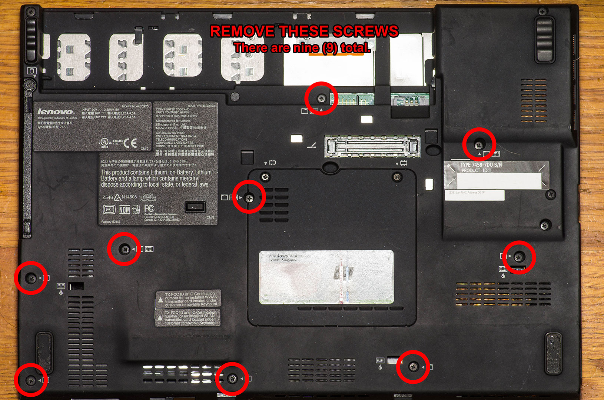
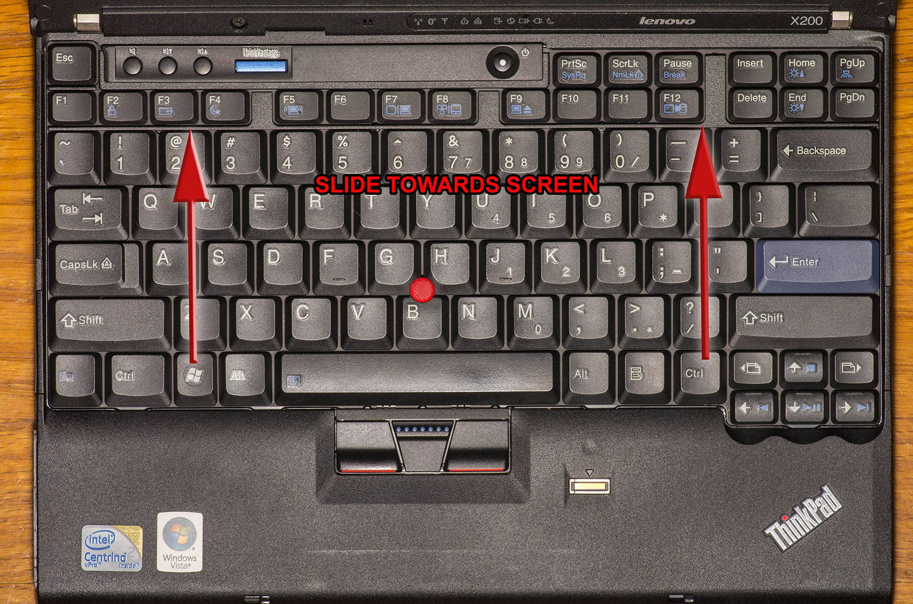
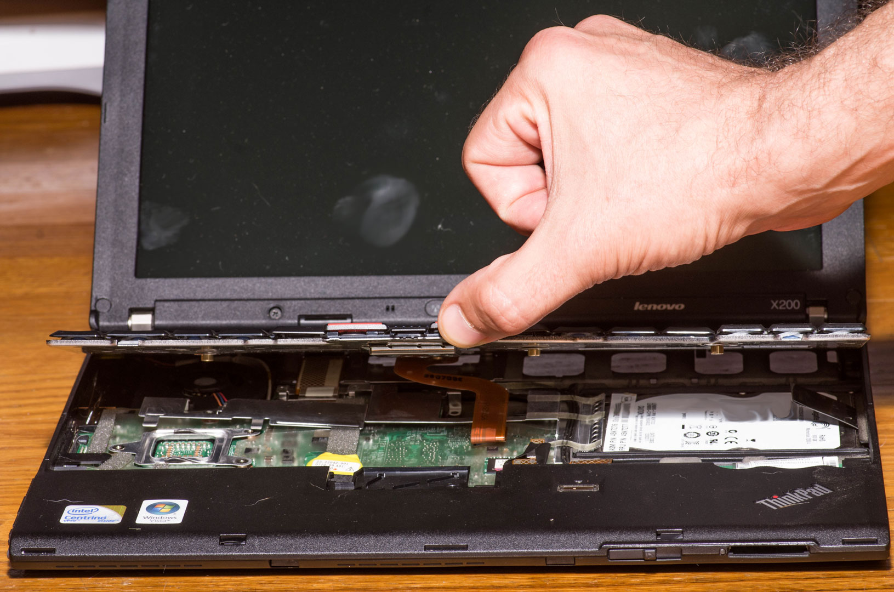
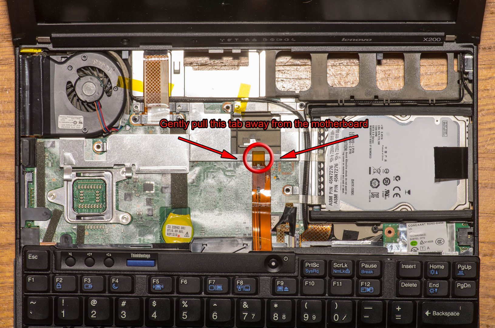
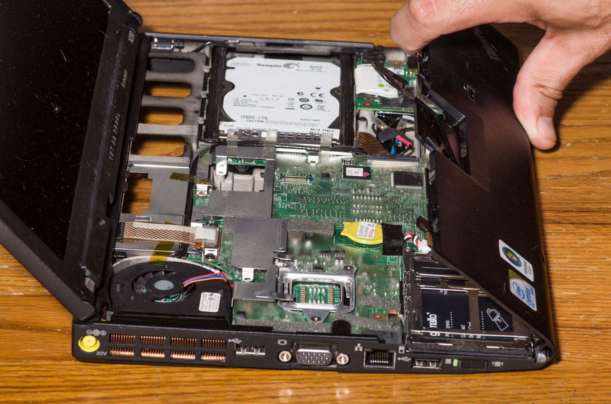
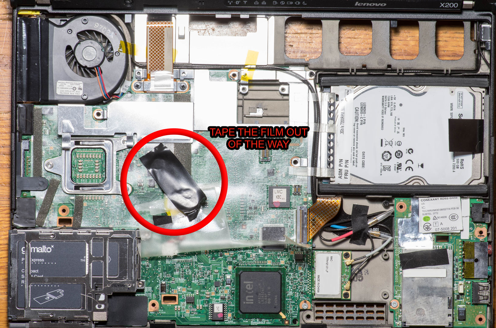
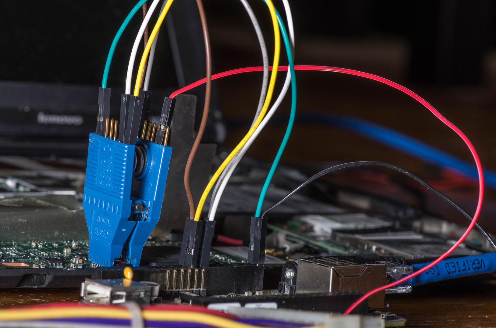
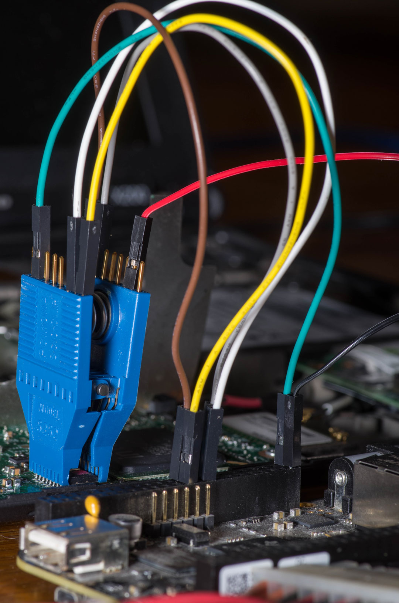
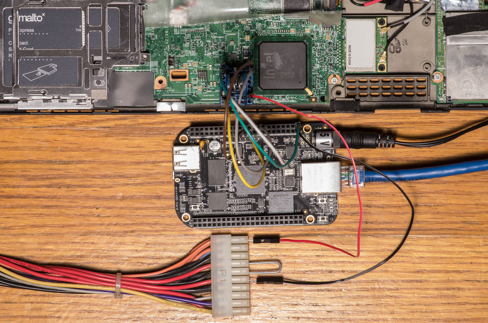

# Flashing my Lenovo x200 with Libreboot


> [!NOTE]
> This guide is fairly old (2020/2021) and I haven't
> had time to update it with any changes that Libreboot may require.
>
> Most of the steps will still be relevant but I suggest cross-checking
> with the Libreboot site for any necessary updates until I can update
> this guide.
>
> I apologize for any inconveniences this causes.


I accidentally botched my original Libreboot flash during an update, so
I decided to take some pictures and type this guide to hopefully help
someone else.

Main bit of advice here is to read over the directions once before
proceeding then once you start, go slowly!

------------------------------------------------------------------------


> [!CAUTION]
> ##### Disclaimer
>
> *While this process worked for me, you may not have the same results.
> Please do your homework before attempting this and don't blame me if you
> mess something up.*
>
> *I own a Lenovo X200. I haven't used a X200S or a X200T. Refer to
> Libreboot's site for instructions regarding other models.*
>
> *My X200 has a 16 pin, 8Mb chip. I am unfamiliar with other
> configurations. Refer to Libreboot's site for instructions regarding
> other configurations.*
>
> *I am using a desktop computer running Debian Stretch, so you may or may
> not need to change the commands depending on your OS.*


------------------------------------------------------------------------

#### Helpful Info

You can click on the images for a larger size.

For the code blocks on this tutorial, pay attention to the command
prompt. I made sure to keep the hostname relevant to which system the
commands should be run on.

- mainpc - The main computer
- X200 - The X200
- beaglebone - The BBB

After the hostname, it shows the current directory. Eg:

- We're on the main computer in the home (\~) directory:
  ``` bash
  [user@mainpc:~]$
  ```
- We're on the BBB in the armv7l directory:
  ``` bash
  [debian@beaglebone:armv7l]$
  ```

------------------------------------------------------------------------

## Gather Supplies


> [!IMPORTANT]
> ##### Attention
>
> The BeagleBone Black used in this guide is old.\
> Head over to the Libreboot site for updated device recommendations:\
> <https://libreboot.org/docs/install/spi.html>


First, gather the supplies needed to perform the flash.


##### Pictured

- BeagleBone Black
- 5V Power Supply (for the BBB)
- Ponoma 5252 Test Clip
- M to F Breadboard Jumper Cables (preferably 10cm)
- #0 Phillips Screwdriver

##### Not Pictured

- Lenovo X200 - Not X200S or X200T
- Second computer - to connect to the BBB
- Computer PSU - to provide 3.5V
- Large Metal Paperclip - for PSU Jumper and Pins
- Tool to cut Paperclip. eg: Diagonal Pliers or Lineman's Pliers
- Electrical Tape - to tape clear film back and insulate bottom of BBB
  if necessary
- Digital Multimeter - to check voltage

------------------------------------------------------------------------

## Prepare the Files


> [!NOTE]
> These instructions are currently for **Libreboot
> 20160907** which has a different gpg signing key than **Libreboot
> 20210522** and newer!


We need to download the necessary files from the Libreboot site and have
them all set up and ready to go for when we get the BBB connected to the
X200.

From your main computer:

- Create a directory to hold the downloads:
  ``` bash
  [user@mainpc:~]$ mkdir -p ~/libreboot/rom/grub
  ```
- Head over to <https://libreboot.org/download.html>
- Add the GPG key to your keyring:
  ``` bash
  [user@mainpc:~]$ gpg --recv-keys 0x969A979505E8C5B2
  ```
- Select a HTTPS mirror
- Click **stable/ \> 20160907/**
- Right click and download the following to the `~/libreboot` directory:
  - **SHA512SUMS**
  - **SHA512SUMS.sig**
  - **libreboot_r20160907_util.tar.xz**
- Click **rom/ \> grub/**
- Right click and download the following to the
  `~/libreboot/rom/grub directory`
  - **libreboot_r20160907_grub_x200_8mb.tar.xz**


> [!IMPORTANT]
> *You need to verify what size flash chip your X200
> has. That will be done below at the [Checking
> Communication](flash-lenovo-x200-libreboot.md#checking-communication)
> section. If you're not sure, come back to this section once you know
> what rom to download.*


- You should now have a file structure that looks similar to this:
  ``` bash
  [user@mainpc:~]$ cd ~/libreboot
  [user@mainpc:libreboot]$ tree
  .
  ├── libreboot_r20160907_util.tar.xz
  ├── rom
  │   └── grub
  │       └── libreboot_r20160907_grub_x200_8mb.tar.xz
  ├── SHA512SUMS
  └── SHA512SUMS.sig

  2 directories, 4 files
  ```

------------------------------------------------------------------------

### Verify the Files

Now we can verify that the files we downloaded are the same as what is
on the server and that they weren't tampered with or switched during
download.

- Change directories:
  ``` bash
  [user@mainpc:~]$ cd ~/libreboot
  ```
- Verify the files:
  ``` bash
  [user@mainpc:libreboot]$ sha512sum -c SHA512SUMS 2>/dev/null | grep OK
  ./libreboot_r20160907_util.tar.xz: OK
  ./rom/grub/libreboot_r20160907_grub_x200_8mb.tar.xz: OK
  ```
- Verify gpg signatures:
  ``` bash
  [user@mainpc:libreboot]$ gpg --verify SHA512SUMS.sig
  gpg: assuming signed data in 'SHA512SUMS'
  gpg: Signature made Wed 07 Sep 2016 06:15:17 PM EDT
  gpg:                using RSA key 969A979505E8C5B2
  gpg: Good signature from "Leah Rowe (Libreboot signing key) <info@minifree.org>" [unknown]
  gpg: WARNING: This key is not certified with a trusted signature!
  gpg:          There is no indication that the signature belongs to the owner.
  Primary key fingerprint: CDC9 CAE3 2CB4 B7FC 84FD  C804 969A 9795 05E8 C5B2
  ```

------------------------------------------------------------------------

### Extract the Files

- Extract the utilities:
  ``` bash
  [user@mainpc:libreboot]$ tar xvf libreboot_r20160907_util.tar.xz
  ```
- Change to rom/grub directory:
  ``` bash
  [user@mainpc:libreboot]$ cd rom/grub/
  ```
- Extract the ROMs:
  ``` bash
  [user@mainpc:grub]$ tar xvf libreboot_r20160907_grub_x200_8mb.tar.xz
  ```
- Copy and rename the ROM we will use to \~/libreboot:
  ``` bash
  [user@mainpc:grub]$ cp libreboot_r20160907_grub_x200_8mb/x200_8mb_usqwerty_vesafb.rom ~/libreboot/libreboot.rom
  ```

------------------------------------------------------------------------

### Obtain the MAC Address

We need to set the MAC address for our wired interface in the rom. There
are a few ways to get it.

- Look at the sticker on the bottom of the laptop.
- If you have an OS installed on the X200 (or using a live usb):
  ``` bash
  [user@X200:~]$ ip link show eth0
  2: eth0: <NO-CARRIER,BROADCAST,MULTICAST,UP,LOWER_UP> mtu 1500 qdisc pfifo_fast state UP mode DEFAULT group default qlen 1000
      link/ether XX:XX:XX:XX:XX:XX brd ff:ff:ff:ff:ff:ff
  ```
- Read the first 6 bytes from position `0x1000` of the factory.rom:
  ``` bash
  [debian@beaglebone:libreboot]$ xxd -s 0x1000 -l 6 factory.rom
  00001000: XXXX XXXX XXXX ...'PH
  ```

  - If you need to use the factory.rom method, wait until you [dump the
    factory
    rom](flash-lenovo-x200-libreboot.md#backup-factory-rom)
    to get the mac address, then come back and finish these steps.

------------------------------------------------------------------------

### Prepare the ROM

- Check architecture:
  ``` bash
  [user@mainpc:libreboot]$ uname -m
  x86_64
  ```
- Change directories:
  ``` bash
  [user@mainpc:libreboot]$ cd ~/libreboot/libreboot_r20160907_util/ich9deblob/x86_64/
  ```
- Change the Xs to the MAC from the steps above:
  ``` bash
  [user@mainpc:grub]$ ./ich9gen --macaddress XX:XX:XX:XX:XX:XX
  ```
- Write the generated file to the ROM:
  ``` bash
  [user@mainpc:grub]$ dd if=ich9fdgbe_8m.bin of=~/libreboot/libreboot.rom bs=12k count=1 conv=notrunc status=progress
  ```

------------------------------------------------------------------------

## Disassemble the x200

Remove the battery then proceed to take the screws out of the bottom of
the X200. I circled the nine screws in the image below 




After removing the screws, flip the X200 over and open it up. Place your
fingers somewhere around the \<Ctrl\> keys and push towards the screen.
You shouldn't need much pressure for it to slide forward. It won't go
very far, maybe 1/8″.




Once it slides forward, you can pry it up from the mouse buttons. Be
careful not to pull it too far out, it's still connected to the
motherboard. I just laid it on the palm rest.




Grab the tab circled in the picture below and pull it away from the
motherboard to disconnect the keyboard. After it's disconnected, set the
keyboard aside.




With the keyboard out of the way, you can now see the connector from the
Fingerprint Sensor. On my previous flash a few years ago, I had already
disconnected mine and I didn't think to edit picture to circle it until
after I put everything back together. (In the image above, it's the
smaller ribbon cable with black tape on it.)

After you disconnect the Fingerprint Sensor, you can lightly pull from
where the keyboard used to be and lift the palm rest away from the X200.
Once it's free, set it aside.




Now would be a good time to disconnect the camera, microphone and any
other devices if you want to. You could also continue disassembling the
laptop so you can apply some fresh thermal paste to the processor but I
won't cover any of that here.

You should now be able to see the chip we need to access in order to
flash Libreboot. I have it circled in the image below. I also labeled
the pins so you know the order that they are numbered for when it's time
to connect them to the BBB.
Peel the clear plastic film back to keep it out of the way. I used
electrical tape and taped it to the CMOS Battery.




------------------------------------------------------------------------

## Prepare the BeagleBone Black

I chose to do a fresh install of the OS before flashing my X200. I would
at least recommend updating the BBB so you can follow along with this
tutorial. Somewhere between the time I originally bought the BBB and
now, they changed the process of enabling SPI for the pins.

If you would like to update the MMC on the BeagleBone Black, head over
there and follow the instructions. I'll get a guide going soon and will
update this post with a link.

- <https://beagleboard.org/getting-started#update>
- <https://elinux.org/Beagleboard:BeagleBoneBlack_Debian#Flashing_eMMC>

After you have a fresh OS installed or updated the existing OS , make
sure you can SSH to it from another computer.

- Transfer files to the BBB:
  ``` bash
  [user@mainpc:~]$ scp -r ~/libreboot debian@192.168.xx.xx:~/
  ```

<!-- -->

- SSH to the BBB:
  ``` bash
  [user@mainpc:~]$ ssh debian@192.168.xx.xx
  ```

<!-- -->

- Configure the pins:
  ``` bash
  [debian@beaglebone:~]$ config-pin P9.17 spi_cs
  [debian@beaglebone:~]$ config-pin P9.18 spi
  [debian@beaglebone:~]$ config-pin P9.21 spi
  [debian@beaglebone:~]$ config-pin P9.22 spi_sclk
  ```

------------------------------------------------------------------------

## Check Voltage

If you're using an old PSU with a 20 pin connector, I would highly
recommend verifying that you're using the correct pins before connecting
it to the flash chip. Applying more than 3.5 Volts to the chip can
destroy the chip so proceed with caution!

First we need to make a jumper to go from the green wire to the black
wire so the PSU will turn on. The smaller bend of a large paper clip
fits perfectly. After the jumper is installed, go ahead and plug in the
PSU.

Once the PSU is running, check voltage between any Orange wire and any
Black wire. You should have roughly 3.5 Volts DC. I had to bend some
pieces of paper clips to hold the test leads while I took a picture.


------------------------------------------------------------------------

## Make Connections

Here's the order in how I connected things and was successful. YMMV. I
made sure to connect the grounds first as a safety measure. I connected
the 3.3 Volts last.

#### Connect the Wires

1.  **PIN 2** on the **BBB** to **BLACK** on the **PSU**
2.  Affix the Ponoma 5252 Clip to the CMOS Chip.
3.  **PIN 1** on the **BBB** to **PIN 10** on the **X200**
4.  **PIN 17** on the **BBB** to **PIN 7** on the **X200**
5.  **PIN 18** on the **BBB** to **PIN 15** on the **X200**
6.  **PIN 21** on the **BBB** to **PIN 8** on the **X200**
7.  **PIN 22** on the **BBB** to **PIN 16** on the **X200**
8.  **PIN 2** on the **X200** to **ORANGE (3.5V)** on the **PSU**









------------------------------------------------------------------------

## Checking Communication

Now that we're all connected we need to verify that we can communicate
with the chip.

- Check the architecture:
  ``` bash
  [debian@beaglebone:~]$ uname -m
  armv7l
  ```
- Change directories:
  ``` bash
  [debian@beaglebone:~]$ cd ~/libreboot/libreboot_r20160907_util/flashrom/armv7l/
  ```
- Run flashrom:
  ``` bash
  [debian@beaglebone:armv7l]$ ./flashrom -p linux_spi:dev=/dev/spidev1.0,spispeed=512
  flashrom v0.9.9-unknown on Linux 4.14.58-ti-r66 (armv7l)
  flashrom is free software, get the source code at https://flashrom.org

  Calibrating delay loop... OK.
  Found Macronix flash chip "MX25L6405D" (8192 kB, SPI) on linux_spi.
  No operations were specified.
  ```

You can see that it found the Macronix flash chip and that it's 8192kB.
That lets us know that we need to use the 8Mb rom from the Libreboot
mirror. If you need to, go back to [Prepare the
Files](flash-lenovo-x200-libreboot.md#prepare-the-files)
and download the proper rom and follow the steps up to disassembling the
X200.

------------------------------------------------------------------------

## Backup Factory ROM

We need to make at least two copies of the factory rom, then check the
shasums so we can verify that they are the same. If they are different,
keep trying. You may want to check the connections between the BBB and
the chip and/or the length of the wires. Reducing the spispeed may also
help.

I used the time command to show how long it took to complete the
transfer. You don't have to use it if you don't want to but at least
this gives you an idea on what to expect time-wise.

- Create backup one:
  ``` bash
  [debian@beaglebone:armv7l]$ time ./flashrom -p linux_spi:dev=/dev/spidev1.0,spispeed=512 -r factory.rom
  flashrom v0.9.9-unknown on Linux 4.14.58-ti-r66 (armv7l)
  flashrom is free software, get the source code at https://flashrom.org

  Calibrating delay loop... OK.
  Found Macronix flash chip "MX25L6405D" (8192 kB, SPI) on linux_spi.
  Reading flash... done.

  real    2m28.221s
  user    0m1.029s
  sys 0m4.249s
  ```
- Create backup two:
  ``` bash
  [debian@beaglebone:armv7l]$ time ./flashrom -p linux_spi:dev=/dev/spidev1.0,spispeed=512 -r factory1.rom
  flashrom v0.9.9-unknown on Linux 4.14.58-ti-r66 (armv7l)
  flashrom is free software, get the source code at https://flashrom.org

  Calibrating delay loop... OK.
  Found Macronix flash chip "MX25L6405D" (8192 kB, SPI) on linux_spi.
  Reading flash... done.

  real    2m28.149s
  user    0m0.830s
  sys 0m4.397s
  ```

<!-- -->

- Verify Factory ROMs are the same:
  ``` bash
  [debian@beaglebone:armv7l]$ sha512sum factory*.rom
  45ea8db426c0fb776d397cfc4312cef2eb8262463538fb927dd0ebb98386218d2b3b64ae6bc5b454279e442de2b6dd30eb4bb584de6be4a09d05ffb20a633330  factory.rom
  45ea8db426c0fb776d397cfc4312cef2eb8262463538fb927dd0ebb98386218d2b3b64ae6bc5b454279e442de2b6dd30eb4bb584de6be4a09d05ffb20a633330  factory1.rom
  ```

<!-- -->

- Store the factory.rom somewhere safe. You may need it for recovery
  purposes or to revert back to factory BIOS some day.

<!-- -->

- Now is the time to get the mac address if you needed to for [Prepare
  the
  ROM](flash-lenovo-x200-libreboot.md#prepare-the-rom)
  steps above.

------------------------------------------------------------------------

## Flashing Libreboot

And now for the moment of truth!

- Flash the chip:
  ``` bash
  [debian@beaglebone:armv7l]$ time ./flashrom -p linux_spi:dev=/dev/spidev1.0,spispeed=512 -w libreboot.rom 
  flashrom v0.9.9-unknown on Linux 4.14.58-ti-r66 (armv7l)
  flashrom is free software, get the source code at https://flashrom.org

  Calibrating delay loop... OK.
  Found Macronix flash chip "MX25L6405D" (8192 kB, SPI) on linux_spi.
  Reading old flash chip contents... done.
  Erasing and writing flash chip... Erase/write done.
  Verifying flash... VERIFIED.

  real    4m55.443s
  user    0m2.090s
  sys 0m8.595s
  ```

Now you can breathe a sigh of relief. That VERIFIED is a beautiful thing
to see!!

------------------------------------------------------------------------

### WiFi

If you're planning on using wifi, it is recommended to replace the
factory Intel wifi chip. The factory chip requires proprietary software
to work correctly, and we're librebooting to rid our x200 of closed
source software!

For reference, I replaced mine with an Atheros 9285G and the Libreboot
tutorial shows them using a Atheros AR5B95.

------------------------------------------------------------------------

## Reassembly

You can now proceed to reassemble the laptop in the reverse order that
it was disassembled.

1.  Palmrest
2.  Keyboard - Don't forget to plug it back in!!
3.  Screws
4.  Battery

------------------------------------------------------------------------

## Finishing Up

Now you can install your favorite GNU distro!

<https://libreboot.org/docs/gnulinux/>

------------------------------------------------------------------------

## Troubleshooting

Here are some of the solutions to common problems that I've come across.

- Make sure you're using the proper util tool for the architecture of
  your system.
- Cable Length; shorter = better
- Double check connections
- Try a slower spispeed
- Check BBB Pin options:
  ``` bash
  # List available pin configurations
  [debian@beaglebone:~]$ config-pin -l P9.17
  default gpio gpio_pu gpio_pd gpio_input spi_cs i2c pwm pru_uart
  [debian@beaglebone:~]$ config-pin -l P9.18
  default gpio gpio_pu gpio_pd gpio_input spi i2c pwm pru_uart
  [debian@beaglebone:~]$ config-pin -l P9.21
  default gpio gpio_pu gpio_pd gpio_input spi uart i2c pwm pru_uart
  [debian@beaglebone:~]$ config-pin -l P9.22
  default gpio gpio_pu gpio_pd gpio_input spi_sclk uart i2c pwm pru_uart
  ```

------------------------------------------------------------------------

## Conclusion

This was a fun little project but I didn't realize how many steps were
involved until I started writing this guide. When I was in the process
of doing the flash, it didn't seem so long and complex. I struggled in
attempting to give enough information without over complicating things
or rambling on. I hope I succeeded in creating an easy to follow
tutorial.

Feel free to leave a comment if you have any troubles and I'll do my
best to help.

------------------------------------------------------------------------
