# Flashing my Lenovo x230 with Coreboot


{: .note }
> This guide is fairly old (2020/2021) and I haven't
> had time to update it with any changes that Coreboot may require.
>
> Most of the steps will still be relevant but I suggest cross-checking
> with the Coreboot site for any necessary updates until I can update this
> guide.
>
> I apologize for any inconveniences this causes.


I flashed my Lenovo x230 with Coreboot and documented how I did it.

This procedure has a good amount more steps than the [Libreboot
X200](../lenovo-x200/flash-lenovo-x200-libreboot.md) Flash. Mainly it
is due to having to build and configure Coreboot & friends.

I urge you to check the sites I list below and cross-reference them with
my information. I may have some typos and the people who wrote them are
probably a lot more knowledgeable than I am when it comes to this stuff.
I am good at following directions and figuring things out, then
documenting it.

Main bit of advice here is to read over the directions once before
proceeding then once you start, go slowly!


{: .caution }
> ##### Disclaimer
>
> *While this process worked for me, you may not have the same results.
> Please do your homework before attempting this and don't blame me if you
> mess something up.*
>
> *I own a Lenovo X230. I haven't used a X230T. Refer to Coreboot's site
> for instructions regarding other models.*
>
> *My X230 has two 8 pin chips. One 4M and one 8M. I am unfamiliar with
> other configurations. Refer to Coreboot's site for instructions
> regarding other configurations.*
>
> *I am using a desktop computer and/or a Lenovo P50 running Debian
> Stretch, so you may or may not need to change the commands depending on
> your OS.*


------------------------------------------------------------------------

## Gather Supplies


{: .warning }
> It is NOT recommended to use the CH341a!\
> The following page for recommendations and an explanation of why the
> CH341a is not advised:\
> <https://libreboot.org/docs/install/spi.html#do-not-use-ch341a>


First, we need to gather the supplies that we need to perform the flash.
This time, we will be using a CH341a instead of the BeagleBone Black
that I used on the [Libreboot
X200](../lenovo-x200/flash-lenovo-x200-libreboot.md) Flash.


##### Pictured

- CH341a
- Ponoma 5250 Test Clip
- F to F Breadboard Jumper Cables
- #0 Phillips Screwdriver
- Electrical Tape

 

##### Not Pictured

- Lenovo x230
- Main Computer
- Digital Multimeter


------------------------------------------------------------------------

## Prepare the Main PC

Now we need to install some packages on our **mainpc** in order for this
to work. Keep in mind I'm using Debian 10.3 for this; your system may
have different requirements and/or package names.

    # Feel free to remove the backslashes and put it all on one line.
    # I did that here for readability.
    [user@mainpc:~]$ sudo apt install -y \
    bison \
    build-essential \
    curl \
    flashrom \
    flex \
    git \
    gnat \
    libncurses5-dev \
    m4 \
    rename \
    zlib1g-dev

------------------------------------------------------------------------

## Prepare the Files

Most users will be perfectly happy just using SeaBIOS which can be
selected and compiled from within Coreboot's make-nconfig section.

I created a directory in my home folder named X230 to keep things
organized. It should look similar to this once we're finished with this
step:

    [user@mainpc:~]$ tree -d -L 1 X230
    X230
    ├── bios-backup
    ├── coreboot

- **bios-backup** - to hold the Factory ROM Backup
- **coreboot** - it'll be created when we clone the coreboot git repo

------------------------------------------------------------------------

### Coreboot

For our next step we'll clone the Coreboot git repo.

    [user@mainpc:X230]$ git clone https://review.coreboot.org/coreboot
    [user@mainpc:X230]$ cd coreboot
    [user@mainpc:coreboot]$ git submodule update --init --checkout
    [user@mainpc:coreboot]$ make crossgcc-i386 CPUS=$(nproc)
    [user@mainpc:coreboot]$ make crossgcc-x64 CPUS=$(nproc)
    [user@mainpc:coreboot]$ make ~/X230/coreboot/util/ifdtool

- **crossgcc-i386** -- Build the crossgcc compiler with i386 support.
- **crossgcc-x64** -- Build the crossgcc compiler with 64bit support.
- **ifdtool** -- Extracts the blobs from our bios.
- **nvramtool** -- Reads/Writes Coreboot parameters.

------------------------------------------------------------------------

## Disassemble the X230

First things first, remove the battery. Then, grab your screwdriver and
remove the 7 screws circled in the image below.
Slide the keyboard toward the screen then lift out of the way. While
doing this, be careful not to yank it because it's still attached to the
motherboard!
Once it's lifted out of the way, you can pull the ribbon cable off using
the small tab; or you can choose to just lay the keys against the laptop
without disconnecting it.

I chose to leave it connected:
Next, gently pry the palm rest back then remove it:
I opted to leave the wire attached and lay it out of the way, on top of
the keyboard.
Finally, peel the protective film back from the bottom left corner to
allow access to the bios chips then tape it so it stays out of the
way.

------------------------------------------------------------------------

## Check Voltage


{: .important }
> Some Black CH341a programmers may be
> providing **5V** to from GND to the other pins.
>
> - **GND\>MOSI=5V**
> - **GND\>MISO=5V**
> - **Gnd\>CLK=5V**
> - **Gnd\>CS=5V**
>
> If yours measures **5V** to the other pins there are modifications you
> can do to fix the issue or flash at your own risk.
>
> I modified my programmer to provide the 3.3V, [SEE POST
> HERE](../../usb-devices/ch341a/3v-ch341a-mod.md)


To be on the safe side, I always check the voltage to make verify that I
am connecting to the correct pin and to be sure that the device is
providing the proper amount. It doesn't take long and provides peace of
mind.

Plug the CH341a into your mainpc then measure the voltage between the
3.3V pin and the GND pin.

You also want to ensure that your programmer is providing 3.3V from GND
to each of the other pins we will be using.

#### Stock Black CH341a


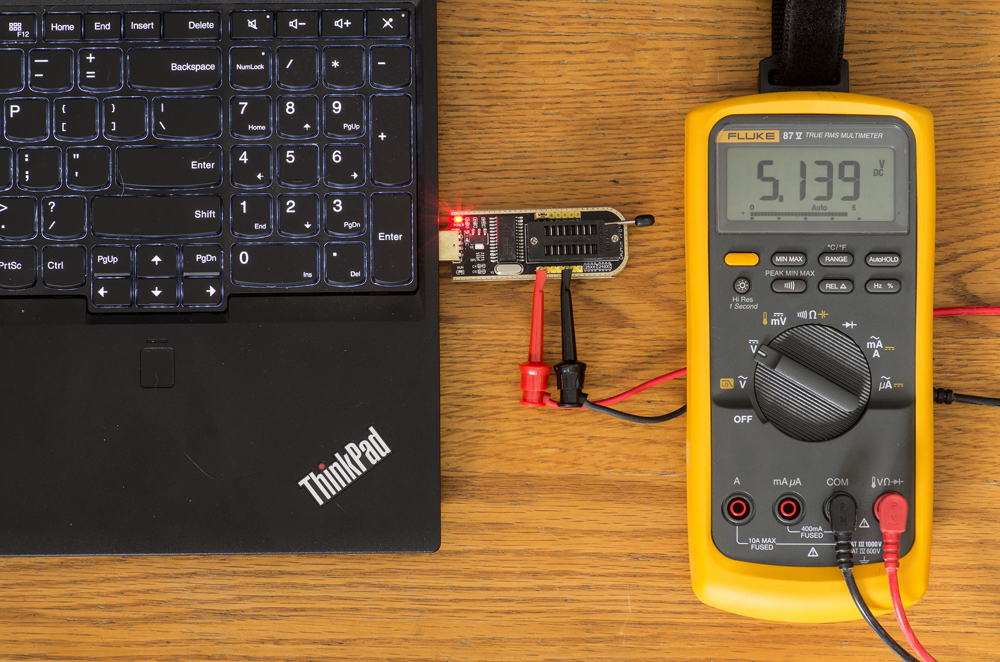


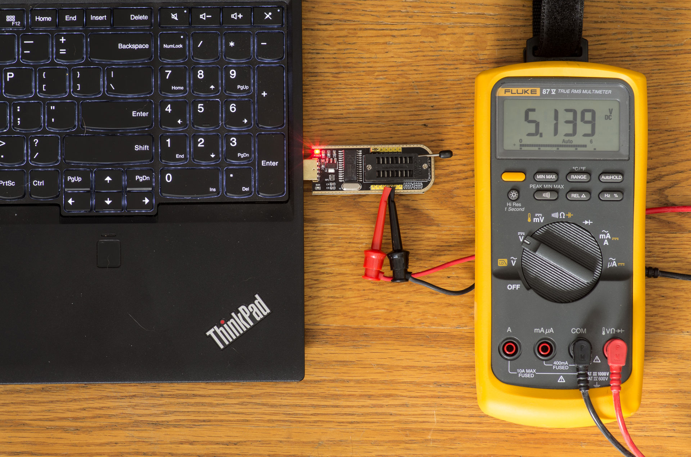


#### Modified Black CH341a


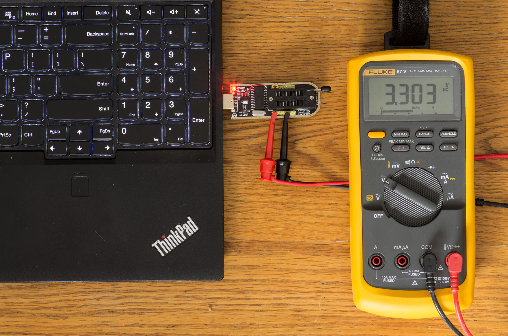

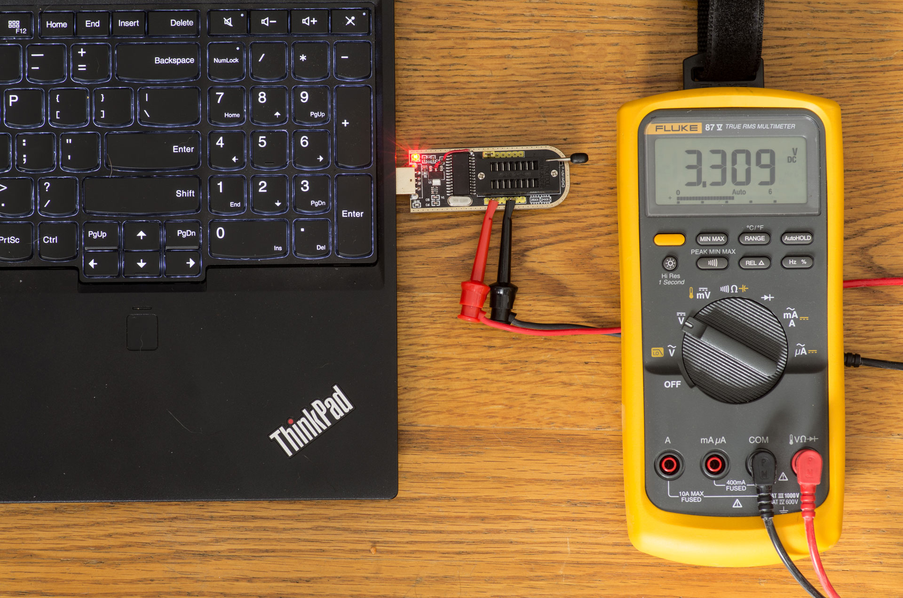

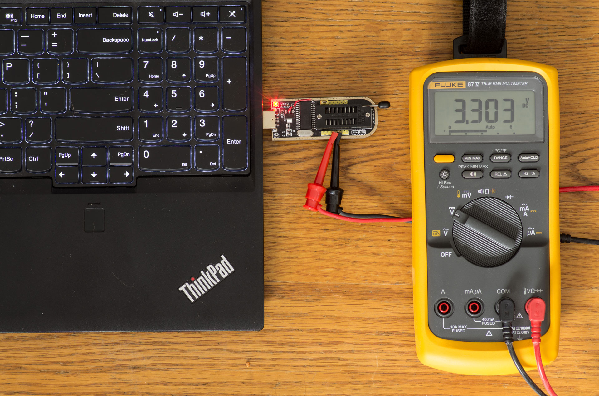

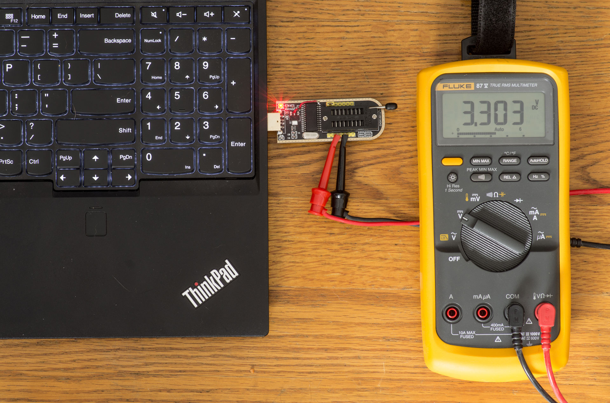


{: .tip }
> I modified the ch341a to provide the 3.3V, [SEE POST
> HERE](../../usb-devices/ch341a/3v-ch341a-mod.md)


------------------------------------------------------------------------

## Make Connections

Now we can connect the CH341a to the Ponoma 5250 Clip. I prefer to leave
the power disconnected until the clip is attached to the bios chip. Not
sure if it's better to do it that way or not; it's just my personal
preference.

#### CH341a

I bought the special adapter that connects to the top of the CH341a but
then realized that these pins have the connections we need. In the past,
I've read a few forum posts (
[ONE](https://www.reddit.com/r/coreboot/comments/8b5m8g/ch341a_usb_flasher_and_335v/),
[TWO](https://www.eevblog.com/forum/repair/ch341a-serial-memory-programmer-power-supply-fix/),
[THREE](https://www.win-raid.com/t796f16-Guide-Using-CH-A-based-programmer-to-flash-SPI-EEPROM-5.html#msg43126))
that state that this black version doesn't provide the proper voltage
through that method anyways.

#### Bottom

The bottom of the CH341a has labels of what each pin is for, although
there is a misprint of MIOS (supposed to read MISO)

#### Top

Transfer those labels to the top and we get the pins we need to perform
the flash. Make sure the jumper is connected on the other side to pins 1
and 2.

#### X230

Here's an image of the BIOS Chips inside the X230 with the pins labeled.

To make it easier on myself, I made a line diagram in draw.io and kept
it open to verify which color wire connected to which pin. I thought I
saved it but can't seem to find it anywhere.

------------------------------------------------------------------------

## Verify Communication

Let's verify that we can communicate with the chips before performing
any more operations on the X230.


{: .note }
> You don't have to check both chips here; once
> you receive verification that communication was successful, you can
> proceed to back up that chip. Then move to the other chip, verify
> communication, then back up that chip.


------------------------------------------------------------------------

### Top Chip

Connect the clip to the top chip, then attach the power wire to the
proper pin on the clip:
Then connect power:
Now run `flashrom` to read the chip:

    [user@mainpc:~]$ sudo flashrom -p ch341a_spi
    [sudo] password for user: 
    flashrom v0.9.9-r1954 on Linux 4.9.0-8-amd64 (x86_64)
    flashrom is free software, get the source code at https://flashrom.org

    Calibrating delay loop... OK.
    Found Macronix flash chip "MX25L3205(A)" (4096 kB, SPI) on ch341a_spi.
    Found Macronix flash chip "MX25L3205D/MX25L3208D" (4096 kB, SPI) on ch341a_spi.
    Found Macronix flash chip "MX25L3206E/MX25L3208E" (4096 kB, SPI) on ch341a_spi.
    Found Macronix flash chip "MX25L3273E" (4096 kB, SPI) on ch341a_spi.
    Multiple flash chip definitions match the detected chip(s): "MX25L3205(A)", "MX25L3205D/MX25L3208D", "MX25L3206E/MX25L3208E", "MX25L3273E"
    Please specify which chip definition to use with the -c <chipname> option.

Notice that it finds multiple versions of the chip. If you are able to
read the print on your chips, there are numbers that match the output of
the above command. Mine had "MX25L3206E" printed on it as you can see in
the photo above.

Disconnect the power wire, then disconnect the clip from the top chip.

------------------------------------------------------------------------

### Bottom Chip

Connect the clip to the bottom chip, then attach the power wire to the
proper pin on the clip.
Then connect power:
Now run `flashrom` to read the chip:

    [user@mainpc:~]$ sudo flashrom -p ch341a_spi -r bottom.bin
    [sudo] password for user: 
    flashrom v0.9.9-r1954 on Linux 4.9.0-8-amd64 (x86_64)
    flashrom is free software, get the source code at https://flashrom.org

    Calibrating delay loop... OK.
    Found Macronix flash chip "MX25L6405" (8192 kB, SPI) on ch341a_spi.
    Found Macronix flash chip "MX25L6405D" (8192 kB, SPI) on ch341a_spi.
    Found Macronix flash chip "MX25L6406E/MX25L6408E" (8192 kB, SPI) on ch341a_spi.
    Found Macronix flash chip "MX25L6436E/MX25L6445E/MX25L6465E/MX25L6473E" (8192 kB, SPI) on ch341a_spi.
    Multiple flash chip definitions match the detected chip(s): "MX25L6405", "MX25L6405D", "MX25L6406E/MX25L6408E", "MX25L6436E/MX25L6445E/MX25L6465E/MX25L6473E"
    Please specify which chip definition to use with the -c <chipname> option.

Once again, it finds multiple versions of the chip. If you are able to
read the print on your chips, there are numbers that match the output of
the above command. For reference, my bottom chip had "MX25L6406E"
printed on it as you can see in the image above.

Disconnect the power wire, then disconnect the clip from the bottom
chip.

------------------------------------------------------------------------

## Backup Factory ROM

Now that we know that we can communicate with the chips, it's time to
back up the factory roms so if anything goes wrong, we can restore it.

You should make *at least* two copies of the factory rom, then check the
`shasums` so you can verify that they are the same. If they are
different, keep trying. You may want to check the connections between
the CH341a and/or the length of the wires. Changing the `spispeed` may
also help.

------------------------------------------------------------------------

### Top Chip

Connect the clip to the top chip, then apply power.

    [user@mainpc:~]$ mkdir -p ~/X230/bios-backup && cd ~/X230/bios-backup
    [user@mainpc:bios-backup]$ sudo flashrom -p ch341a_spi -r factory_top-1.bin -c "MX25L3206E/MX25L3208E"
    flashrom v0.9.9-r1954 on Linux 4.9.0-7-amd64 (x86_64)
    flashrom is free software, get the source code at https://flashrom.org

    Calibrating delay loop... delay loop is unreliable, trying to continue OK.
    Found Macronix flash chip "MX25L3206E/MX25L3208E" (4096 kB, SPI) on ch341a_spi.
    Reading flash... done.
    [user@mainpc:bios-backup]$ sudo flashrom -p ch341a_spi -r factory_top-2.bin -c "MX25L3206E/MX25L3208E"
    flashrom v0.9.9-r1954 on Linux 4.9.0-7-amd64 (x86_64)
    flashrom is free software, get the source code at https://flashrom.org

    Calibrating delay loop... delay loop is unreliable, trying to continue OK.
    Found Macronix flash chip "MX25L3206E/MX25L3208E" (4096 kB, SPI) on ch341a_spi.
    Reading flash... done.

    [user@mainpc:bios-backup]$ sha512sum factory_top-*
    b112f33a82dce8809d744a2a7d255e5b3bc9687aedfcbe6852ae7d6c6305d2309c8301a09a4e7fa61be6deff36010b3a05c0384e29afc4943d402fc1ce17f9cc  factory_top-1.bin
    b112f33a82dce8809d744a2a7d255e5b3bc9687aedfcbe6852ae7d6c6305d2309c8301a09a4e7fa61be6deff36010b3a05c0384e29afc4943d402fc1ce17f9cc  factory_top-2.bin

Disconnect the power, then disconnect the clip from the top chip.

------------------------------------------------------------------------

### Bottom Chip

Connect the clip to the bottom chip, then apply power.

    [user@mainpc:bios-backup]$ sudo flashrom -p ch341a_spi -r factory_bottom-1.bin -c "MX25L6406E/MX25L6408E"
    flashrom v0.9.9-r1954 on Linux 4.9.0-7-amd64 (x86_64)
    flashrom is free software, get the source code at https://flashrom.org

    Calibrating delay loop... delay loop is unreliable, trying to continue OK.
    Found Macronix flash chip "MX25L6406E/MX25L6408E" (8192 kB, SPI) on ch341a_spi.
    Reading flash... done.
    [user@mainpc:bios-backup]$ sudo flashrom -p ch341a_spi -r factory_bottom-2.bin -c "MX25L6406E/MX25L6408E"
    flashrom v0.9.9-r1954 on Linux 4.9.0-7-amd64 (x86_64)
    flashrom is free software, get the source code at https://flashrom.org

    Calibrating delay loop... delay loop is unreliable, trying to continue OK.
    Found Macronix flash chip "MX25L6406E/MX25L6408E" (8192 kB, SPI) on ch341a_spi.
    Reading flash... done.
    [user@mainpc:bios-backup]$ sha512sum factory_bottom-*
    87705b08c2563cb4fc6f0e5cbf3186714ddf865ed29e9815cbbe08094e14f832202cef7b49c07bdf70115a3ed7e0a71b864c45e44196d56349afbb5483c03300  factory_bottom-1.bin
    87705b08c2563cb4fc6f0e5cbf3186714ddf865ed29e9815cbbe08094e14f832202cef7b49c07bdf70115a3ed7e0a71b864c45e44196d56349afbb5483c03300  factory_bottom-2.bin

Disconnect the power, then disconnect the clip from the bottom chip.

------------------------------------------------------------------------

### Combine the files

Finally, we will combine the two chips to create one 12Mb file:

    [user@mainpc:bios-backup]$ cat factory_bottom-1.bin factory_top-1.bin > X230-bios.rom

------------------------------------------------------------------------

## Prepare Coreboot

First, we need to extract the blobs from the BIOS file using the
Coreboot util `ifdtool`:

- **Flash Descriptor** - Intel descriptor
- **BIOS** - BIOS
- **Intel ME** - Intel ME/TXE firmware
- **GbE** - Gigabit Ethernet firmware
- **Platform Data** - unused

<!-- -->

    [user@mainpc:~]$ cp ~/X230/bios-backup/X230-bios.rom ~/X230/coreboot/util/ifdtool/
    [user@mainpc:~]$ cd ~/X230/coreboot/util/ifdtool/
    [user@mainpc:ifdtool]$ make
    [user@mainpc:ifdtool]$ ./ifdtool -x X230-bios.rom 
    File x230-bios.rom is 12582912 bytes
      Flash Region 0 (Flash Descriptor): 00000000 - 00000fff 
      Flash Region 1 (BIOS): 00500000 - 00bfffff 
      Flash Region 2 (Intel ME): 00003000 - 004fffff 
      Flash Region 3 (GbE): 00001000 - 00002fff 
      Flash Region 4 (Platform Data): 00fff000 - 00000fff (unused)

    [user@mainpc:ifdtool]$ echo *.bin
    flashregion_0_flashdescriptor.bin  flashregion_1_bios.bin  flashregion_2_intel_me.bin  flashregion_3_gbe.bin

    [user@mainpc:ifdtool]$ mkdir -p ~/X230/coreboot/3rdparty/blobs/mainboard/lenovo/x230

    [user@mainpc:ifdtool]$ mv ~/X230/coreboot/util/ifdtool/*.bin ~/X230/coreboot/3rdparty/blobs/mainboard/lenovo/x230

    [user@mainpc:ifdtool]$ cd ~/X230/coreboot/3rdparty/blobs/mainboard/lenovo/x230

    # Strip the first 14 characters from the filename (flashregion_#_)
    [user@mainpc:x230]$ rename 's/.{14}//' *.bin

    [user@mainpc:x230]$ mv flashdescriptor.bin descriptor.bin

    [user@mainpc:x230]$ mv intel_me.bin me.bin

    [user@mainpc:x230]$ ls
    bios.bin descriptor.bin gbe.bin me.bin

    [user@mainpc:x230]$ cd ~/X230/coreboot/

------------------------------------------------------------------------

### Configure and Compile Coreboot

Here's where we create the coreboot image. Coreboot has the ME_Cleaner
installed so we'll strip the IntelME also.

    [user@mainpc:coreboot]$ make nconfig


#### General Setup

      * Select: Use CMOS configuration values

 

#### Mainboard

- Select: Mainboard vendor (Lenovo)
- Select: Mainboard model (ThinkPad X230)
  - Select: ROM chip size (12MB)
- Select: (0x100000) Size of CBFS filesystem in ROM

 

#### Chipset

- Include CPU microcode in CBFS (Generate from tree)
- Select: Add Intel descriptor.bin file
  - (3rdparty/blobs/mainboard/\$(MAINBOARDDIR)/descriptor.bin)
- Select: Add Intel ME/TXE firmware
  - (3rdparty/blobs/mainboard/\$(MAINBOARDDIR)/me.bin)
- Select: Verify the integrity of the supplied ME/TXE firmware
- Select: Strip down the Intel ME/TXE firmware
- Select: Add gigabit ethernet firmware
  - (3rdparty/blobs/mainboard/\$(MAINBOARDDIR)/gbe.bin)

 

#### Devices

- Graphics initialization (Use libgfxinit)
- Display
  - Framebuffer mode (Linear "high-resolution" framebuffer)
  - Select: Enable PCIe Clock Power Management
  - Select: Enable PCIe ASPM L1 SubState
- Add a Video Bios Table (VBT) binary to CBFS
  - (src/mainboard/\$(MAINBOARDDIR)/data.vbt)

 

#### Generic Drivers

- Select: PS/2 keyboard init

 

#### Payload

- Select: Add a payload (SeaBIOS)
- SeaBIOS version (1.12.0)
- \(10\) PS/2 keyboard controller initialization timeout (milliseconds)
- (Include generated option rom that implements legacy VGA BIOS
  compatibility
- Use LZMA compression for secondary payloads
- Secondary Payloads:
  - Select: Load coreinfo
  - Select: Load nvramcui
- **Save**
- **Exit**


    [user@mainpc:coreboot]$ make

------------------------------------------------------------------------

#### Pictures


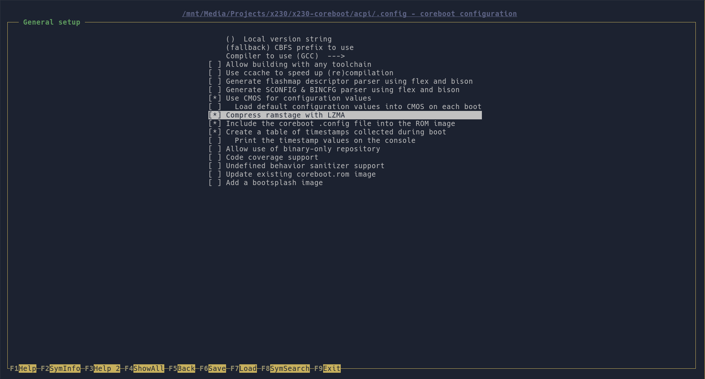

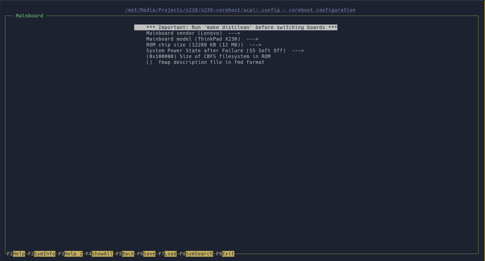

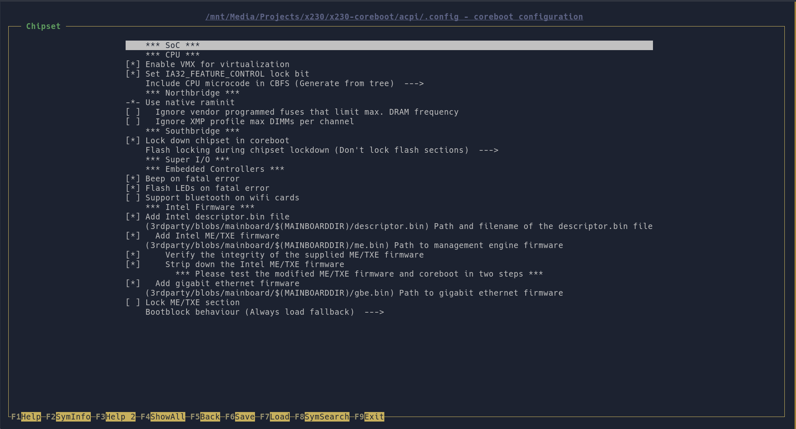

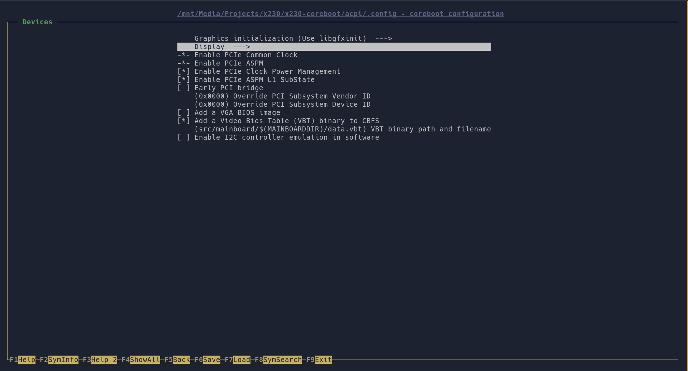

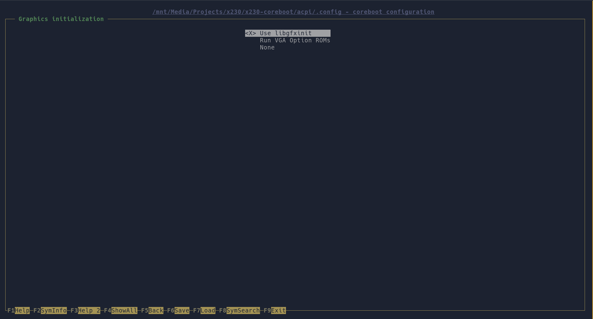

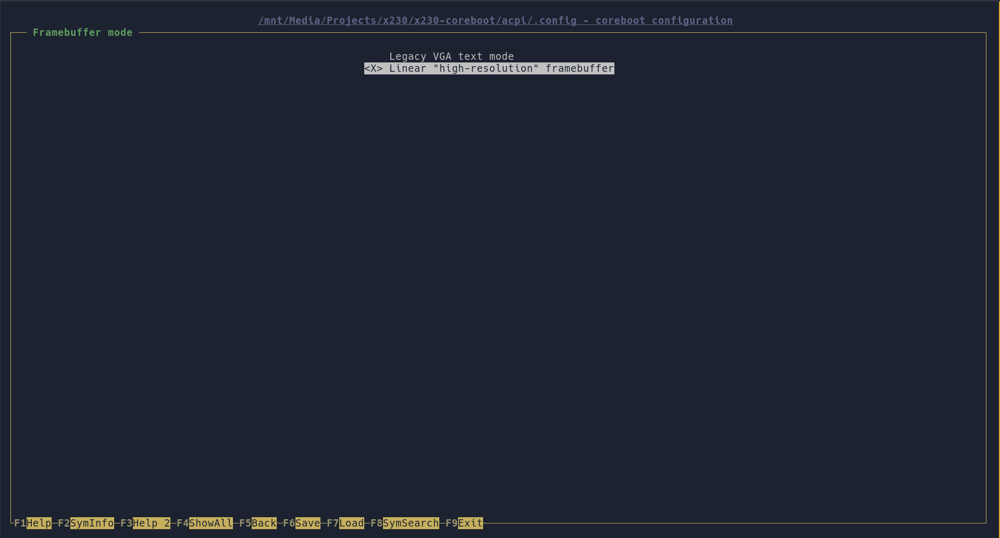

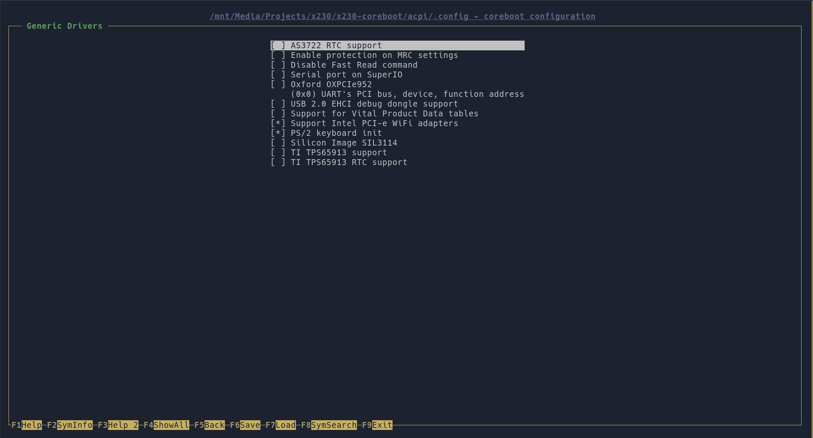

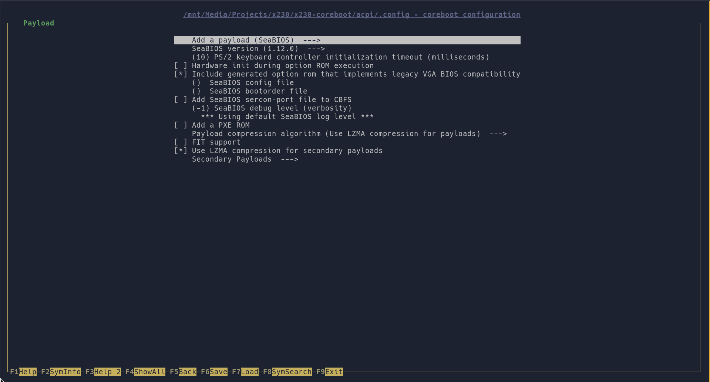


------------------------------------------------------------------------

## Edit Settings

If you would like, you can configure some of Coreboot's system settings
ahead of time:

    [user@mainpc:X230]$ cd util/nvramtool
    [user@mainpc:nvramtool]$ make

    # Show all available options
    [user@mainpc:nvramtool]$ ./nvramtool -C ../../build/coreboot.rom -a
    boot_option = Fallback
    reboot_counter = 0x0
    debug_level = Info
    nmi = Enable
    power_on_after_fail = Disable
    first_battery = Primary
    bluetooth = Disable
    wwan = Disable
    touchpad = Enable
    wlan = Enable
    trackpoint = Enable
    fn_ctrl_swap = Disable
    sticky_fn = Disable
    usb_always_on = Disable
    sata_mode = AHCI
    backlight = Both
    gfx_uma_size = 224M
    volume = 0x3

    # Set gfx_uma_size to max
    [user@mainpc:nvramtool]$ ./nvramtool -C ../../build/coreboot.rom -w gfx_uma_size=224M

    # Disable wwan
    [user@mainpc:nvramtool]$ ./nvramtool -C ../../build/coreboot.rom -w wwan=Disable

    # Disable bluetooth
    [user@mainpc:nvramtool]$ ./nvramtool -C ../../build/coreboot.rom -w bluetooth=Disable

------------------------------------------------------------------------

### Split the ROM

In order to flash the chips on the X230, we need to split the rom into
two files; one 8M file for the bottom chip and one 4M file for the top
chip:

    [user@mainpc:~]$ cd ~/X230/coreboot/build
    [user@mainpc:build]$ dd if=coreboot.rom of=coreboot-bottom.rom bs=1M count=8
    [user@mainpc:build]$ dd if=coreboot.rom of=coreboot-top.rom bs=1M skip=8

------------------------------------------------------------------------

## Flash Coreboot

Everything we've been doing has been leading up to this exciting moment.

Let's push on!

------------------------------------------------------------------------

### Top Chip

    [user@mainpc:build]$ time sudo flashrom --chip "MX25L3206E/MX25L3208E" --programmer ch341a_spi --write coreboot-top.rom
    flashrom v0.9.9-r1954 on Linux 4.9.0-8-amd64 (x86_64)
    flashrom is free software, get the source code at https://flashrom.org

    Calibrating delay loop... OK.
    Found Macronix flash chip "MX25L3206E/MX25L3208E" (4096 kB, SPI) on ch341a_spi.
    Reading old flash chip contents... done.
    Erasing and writing flash chip... Erase/write done.
    Verifying flash... VERIFIED.

    real    1m7.399s
    user    0m3.472s
    sys 0m1.488s

------------------------------------------------------------------------

### Bottom Chip

    [user@mainpc:build]$ time sudo flashrom --chip "MX25L6406E/MX25L6408E" --programmer ch341a_spi --write coreboot-bottom.rom
    flashrom v0.9.9-r1954 on Linux 4.9.0-8-amd64 (x86_64)
    flashrom is free software, get the source code at https://flashrom.org

    Calibrating delay loop... OK.
    Found Macronix flash chip "MX25L6406E/MX25L6408E" (8192 kB, SPI) on ch341a_spi.
    Reading old flash chip contents... done.
    Erasing and writing flash chip... Erase/write done.
    Verifying flash... VERIFIED.

    real    2m48.203s
    user    0m12.332s
    sys 0m4.320s

------------------------------------------------------------------------

### WiFi

If you're planning on using wifi, you can choose to replace the factory
Intel wifi chip with something that has non-proprietary drivers.

For reference, I replaced mine with an Atheros AR9382 and it seems to be
working fine.

There may be better options out there, I didn't spend very much time
researching it. If you know of something better that doesn't require
non-free drivers, please leave a comment below and I'll order one (cost
depending), test it out and update this guide.

------------------------------------------------------------------------

### Bluetooth

You may want to remove the bluetooth module as well. If that sounds like
something you want to do, the bluetooth module is right in front of the
laptop held by one screw. I didn't think to snap a picture.

------------------------------------------------------------------------

### Camera and Microphone

Some people opt to remove the Camera and Microphone as well. I removed
them on my X200 but decided to leave them alone in my X230.

If you're interested in doing so, now would be a great time.

------------------------------------------------------------------------

### Thermal Paste

Since you have the laptop's internals exposed, you could also take some
more screws out and apply some fresh thermal paste to the processor. I'm
sure there are guides online that will assist you in doing that.

------------------------------------------------------------------------

## Reassembly

You can now reassemble the laptop in the reverse order that it was
disassembled.

1.  Press the palmrest into place listening for the snaps affirming it's
    secured in place.
2.  Re-install the keyboard -- (Don't forget to plug it back in if you
    unplugged it!!)
    1.  Slide the top in first
    2.  Lay it down
    3.  "Pull" it back towards the front of the laptop by pressing on
        the keys and pulling towards yourself.
3.  Replace the screws
4.  Install the battery.

------------------------------------------------------------------------

## Finishing Up

Power this puppy up and you should be greeted with the SeaBIOS screen.

I had an issue where my Debian install seemed to hang at loading
initramfs. I could however, enter my encryption password and the system
would continue booting.

If you run into this problem do the following:

``` bash
# append i915 to the end of the file
[user@mainpc:~]$ echo "i915" | sudo tee -a /etc/initramfs-tools/modules

# Re-generate the initramfs
[user@mainpc:~]$ sudo update-initramfs -u

# If grub isn’t full screen you may have to set the resolution:

[user@mainpc:~]$ sudoedit /etc/default/grub

# Uncomment and edit the following line to read:
GRUB_GFXMODE=1366x768x32

[user@mainpc:~]$ sudo update-grub
```

------------------------------------------------------------------------

### Conclusion

This was an interesting and fun project which took part over many
evenings after work. It's still very much a work in progress; just like
all of my other projects!

------------------------------------------------------------------------

### Helpful Links

- [Coreboot Build HOWTO](https://www.coreboot.org/Build_HOWTO)
- [Coreboot Starting From
  Scratch](https://doc.coreboot.org/lessons/lesson1.html)
- [Coreboot ACPI methods
  patch](https://review.coreboot.org/c/coreboot/+/23178)
- [Coreboot
  nvramtool](https://www.coreboot.org/Nvramtool#Commonly_used_CMOS.2FNVRAM_options)
- [SeaBIOS](https://www.seabios.org/SeaBIOS)
- [Install
  Debian](https://libreboot.org/docs/gnulinux/encrypted_debian.html)
- IRC Freenode: #coreboot
