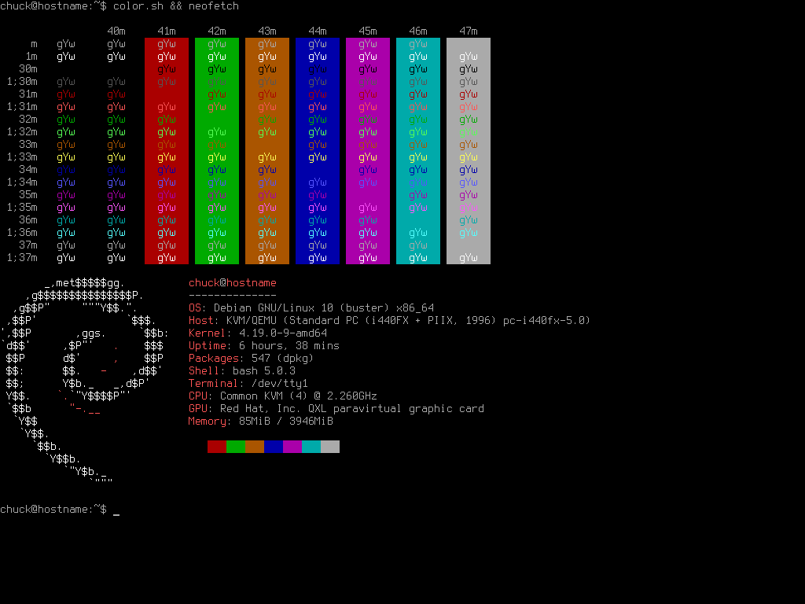

# Default Colorscheme

------------------------------------------------------------------------

## Default VT Colorscheme

Here's the default colorscheme for your virtual terminal (tty).



------------------------------------------------------------------------

### Colors

          color0   color1   color2   color3   color4   color5   color6   color7   color8   color9   color10   color11   color12   color13   color14   color15
  ------- -------- -------- -------- -------- -------- -------- -------- -------- -------- -------- --------- --------- --------- --------- --------- ---------
    red   0        170      0        170      0        170      0        170      85       255      85        255       85        255       85        255
   green  0        0        170      85       0        0        170      170      85       85       255       255       85        85        255       255
   blue   0        0        0        0        170      170      170      170      85       85       85        85        255       255       255       255

------------------------------------------------------------------------

### Script

``` sh
#!/bin/sh

PREREQ=""
prereqs()
{
     echo "$PREREQ"
}

case $1 in
prereqs)
     prereqs
     exit 0
     ;;
esac

# Default
echo "0,170,0,170,0,170,0,170,85,255,85,255,85,255,85,255
0,0,170,85,0,0,170,170,85,85,255,255,85,85,255,255
0,0,0,0,170,170,170,170,85,85,85,85,255,255,255,255" | setvtrgb -
```

\

- [Applying a VT Colorscheme](../virtual_terminal_color.md#applying-a-vt-colorscheme-at-boot)

------------------------------------------------------------------------
