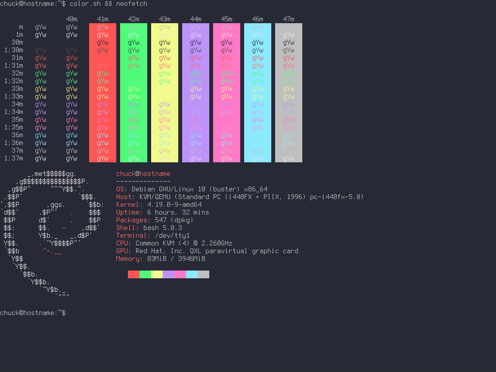

# Dracula Colorscheme

------------------------------------------------------------------------

## Dracula VT Colorscheme

Here's a slightly modified version of the Dracula Colorscheme for your
virtual terminal (tty).



------------------------------------------------------------------------

### Colors

          color0   color1   color2   color3   color4   color5   color6   color7   color8   color9   color10   color11   color12   color13   color14   color15
  ------- -------- -------- -------- -------- -------- -------- -------- -------- -------- -------- --------- --------- --------- --------- --------- ---------
    red   40       255      80       241      189      255      139      191      77       255      90        244       202       255       154       230
   green  41       85       250      250      147      121      233      191      77       110      247       249       169       146       237       230
   blue   54       85       123      140      249      198      253      191      77       103      142       157       250       208       254       230

------------------------------------------------------------------------

### Script

``` sh
#!/bin/sh

PREREQ=""
prereqs()
{
     echo "$PREREQ"
}

case $1 in
prereqs)
     prereqs
     exit 0
     ;;
esac

# Dracula
echo "40,255,80,241,189,255,139,191,77,255,90,244,202,255,154,230
41,85,250,250,147,121,233,191,77,110,247,249,169,146,237,230
54,85,123,140,249,198,253,191,77,103,142,157,250,208,254,230" | setvtrgb -
```

\

- [Applying a VT
  Colorscheme](../virtual_terminal_color.md#applying-a-vt-colorscheme-at-boot)

------------------------------------------------------------------------

## Links

- <https://draculatheme.com/>
