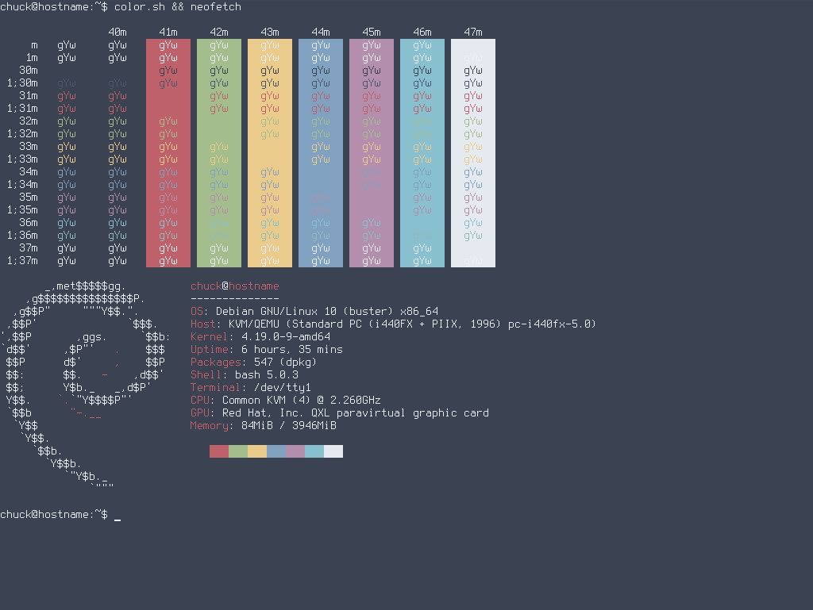

# Nord Colorscheme

------------------------------------------------------------------------

## Nord VT Colorscheme

Here's a slightly modified version of the Nord Colorscheme for your
virtual terminal (tty).



------------------------------------------------------------------------

### Colors

          color0   color1   color2   color3   color4   color5   color6   color7   color8   color9   color10   color11   color12   color13   color14   color15
  ------- -------- -------- -------- -------- -------- -------- -------- -------- -------- -------- --------- --------- --------- --------- --------- ---------
    red   59       191      163      235      129      180      136      229      76       191      163       235       129       180       143       236
   green  66       97       190      203      161      142      192      233      86       97       190       203       161       142       188       239
   blue   82       106      140      139      193      173      208      240      106      106      140       139       193       173       187       244

------------------------------------------------------------------------

### Script

``` sh
#!/bin/sh

PREREQ=""
prereqs()
{
     echo "$PREREQ"
}

case $1 in
prereqs)
     prereqs
     exit 0
     ;;
esac

# Nord
echo "59,191,163,235,129,180,136,229,76,191,163,235,129,180,143,236
66,97,190,203,161,142,192,233,86,97,190,203,161,142,188,239
82,106,140,139,193,173,208,240,106,106,140,139,193,173,187,244" | setvtrgb -
```

\

- [Applying a VT
  Colorscheme](../virtual_terminal_color.md#applying-a-vt-colorscheme-at-boot)

------------------------------------------------------------------------

## Links

- <https://www.nordtheme.com/>
