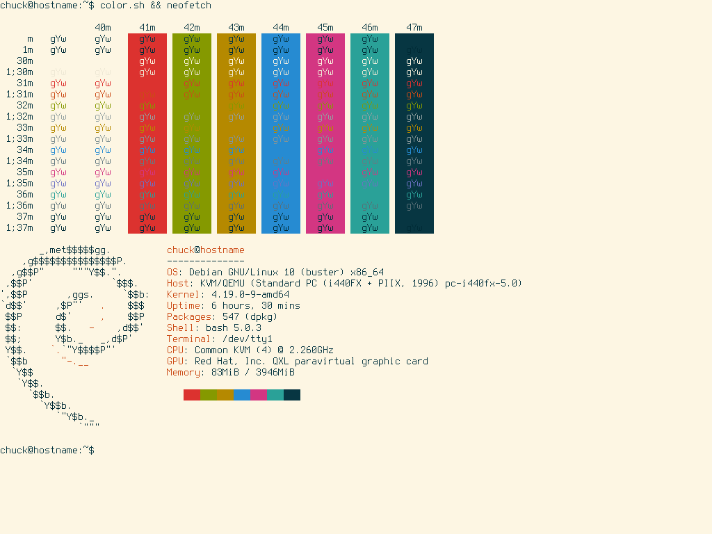

# Solarized Light Colorscheme

------------------------------------------------------------------------

## Solarized Light VT Colorscheme

Here's a slightly modified version of the Solarized Light Colorscheme
for your virtual terminal (tty).

------------------------------------------------------------------------

### Colors

          color0   color1   color2   color3   color4   color5   color6   color7   color8   color9   color10   color11   color12   color13   color14   color15
  ------- -------- -------- -------- -------- -------- -------- -------- -------- -------- -------- --------- --------- --------- --------- --------- ---------
    red   253      220      133      181      38       211      42       7        238      203      147       131       101       108       88        0
   green  246      50       153      137      139      54       161      54       232      75       161       148       123       113       110       43
   blue   227      47       0        0        210      130      152      66       213      22       161       150       131       196       117       54

------------------------------------------------------------------------

### Script

    #!/bin/sh

    PREREQ=""
    prereqs()
    {
         echo "$PREREQ"
    }

    case $1 in
    prereqs)
         prereqs
         exit 0
         ;;
    esac

    # Solarized Light
    echo "253,220,133,181,38,211,42,7,238,203,147,131,101,108,88,0
    246,50,153,137,139,54,161,54,232,75,161,148,123,113,110,43
    227,47,0,0,210,130,152,66,213,22,161,150,131,196,117,54" | setvtrgb -

\

- [Applying a VT Colorscheme](../virtual_terminal_color.md#applying-a-vt-colorscheme-at-boot)

------------------------------------------------------------------------

## Links

- <https://ethanschoonover.com/solarized/>
