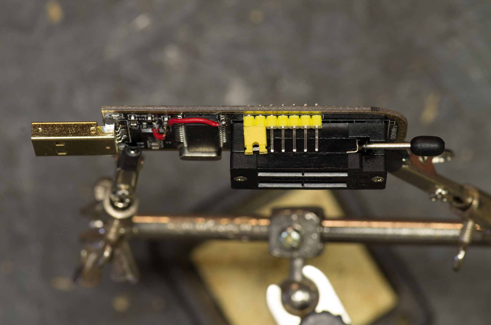
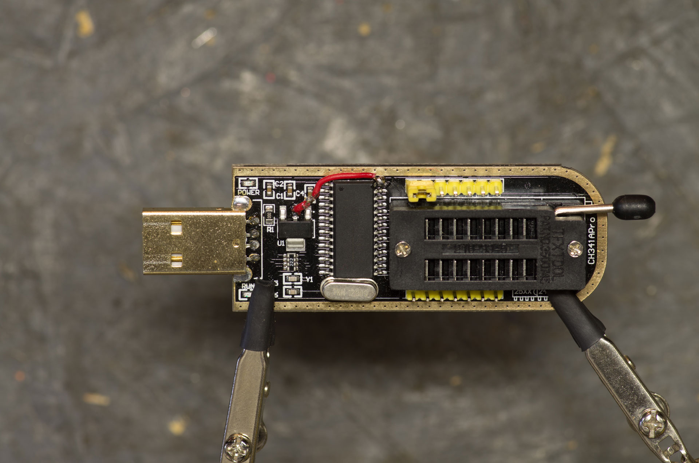

# 3.3V CH341a Signal Output Modification

------------------------------------------------------------------------

{: .warning-title }
> It is NOT recommended to use the CH341a for flashing!\
> The following page for recommendations and an explanation of why the
> CH341a is not advised:\
> <https://libreboot.org/docs/install/spi.html#do-not-use-ch341a>

After realizing that my Black CH341a was not working as intended while
[flashing my x230 with
Coreboot](../../laptop/lenovo-x230/flash-lenovo-x230-coreboot.md), (it was
sending 5V to the signal outputs instead of 3.3V) I decided to attempt
the
[fix](https://www.eevblog.com/forum/repair/ch341a-serial-memory-programmer-power-supply-fix/msg1323775/#msg1323775)
I found online. It went well and only took about 15 minutes. All that is
required is a decent soldering iron, a couple of hand tools, some small
wire and a good amount of patience.

------------------------------------------------------------------------

### Testing for 5V

------------------------------------------------------------------------

{: .note-title }
> ##### Disclaimer
>
> *I am an amateur electronics hobbyist. I like to think that I am fairly
> good at following directions, researching information and using common
> sense. Please, if you are not sure about how or why to do something,
> look it up online or have someone do the work for you! You risk damaging
> your equipment and/or possibly harming yourself.*

------------------------------------------------------------------------

## Supplies Needed

- **Small Wire** - I salvaged some small wire from a automotive 12V cell
  phone charger that I was no longer using (Hooray for never throwing
  things away!). The wire was small enough, but the insulation didn't
  like the heat from the soldering iron. You only need a couple of
  inches at most.
- **Pick** - I had a small pick to assist with manipulating the pin and
  forming the wire afterwards.
- **Wire strippers** - My strippers didn't go to a small enough gauge to
  strip, but I was still able to make it work.
- **Flush Cutters** - I like the precision a pair flush cutters provide
  for trimming the wire.
- **Soldering Iron** - I used a Hakko 936 soldering iron but any decent
  soldering station should do the trick.
- **Solder** - Just some small solder will do the trick.

------------------------------------------------------------------------

### How do we get 3.3V?

We need to lift **pin 28** (VCC) to break it's 5V feed and connect it to
capacitor **C4** (which also connects to **pin 9** (V3)). Then connect
that to the middle pin on the **AMS 1117** (V out). Doing so results in
feeding pin 28 of the CH341A with 3.3V from the output of the AMS1117
voltage regulator chip.

- CH341a
  - **Pin 28** - VCC - Positive power input port
  - **Pin 9** - V3 - Attachment of VCC input external power

<!-- -->

- Capacitor C4 -
- AMS 1117 - Voltage Regulator

------------------------------------------------------------------------

### The Steps

1.  Apply *slight* outward pressure with the pick to pin 28 while
    heating the solder to help free it from the pad. Once it becomes
    free, gently bent it upward so it is away from the circuit board.
2.  Cut the wires to length by holding them in place and eyeballing
    where you need to cut them. You will need one long and one short
    wire. Once cut to your liking, strip and tin the ends.
3.  Solder one end of the long wire to pin 28 and form the other end to
    fit in place near C4.
4.  Solder one end of the short wire to the center pin of the 1117 chip
    and form the other end to meet up with the first wire at capacitor
    C4.
5.  Place and solder both wires to capacitor C4.
6.  Lastly, bend the wires into place being careful not to put too much
    pressure on the solder joints and not bending the pin too much.
7.  To be extra cautious, feel free to place a small piece of electrical
    tape over the pad to prevent any accidental short circuits.

------------------------------------------------------------------------

### Testing for 3.3V

Take out your multi meter and verify voltage. You should now have 3.3V
to all pins.

- GND \> MISO = 3.3V
- GND \> MOSI = 3.3V
- GND \> CS = 3.3V
- GND \> CLK = 3.3V

------------------------------------------------------------------------

### Helpful Links

- [One
  Transistor](https://www.onetransistor.eu/2017/08/ch341a-mini-programmer-schematic.html)
- [EEV
  Blog](https://www.eevblog.com/forum/repair/ch341a-serial-memory-programmer-power-supply-fix/)
- [DS1117 Schematic](http://www.advanced-monolithic.com/pdf/ds1117.pdf)
